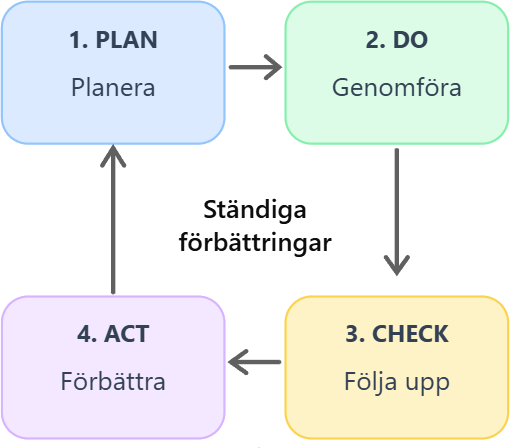

+++
date = '2026-10-18T19:19:04+02:00'
draft = true
title = 'Ständiga förbättringar'
+++

Som jag nämnde i [Processer för dummies](/kvalitet/process_for_dummys/) gör det inget om processen inte är perfekt från början. Det viktiga är att den är ett stöd för medarbetarna.
Om man arbetar enligt processen kommer man förr eller senare att upptäcka saker som kan förbättras. Det är precis så ständiga förbättringar fungerar.

Tänk att det står "en gnutta salt" i ett recept. Hur mycket salt är egentligen en gnutta?
Det beror förstås på vem som bakar. Olika personer har olika uppfattningar om hur mycket salt som behövs.
Om bullarna börjar smaka olika trots att alla följer receptet kan man förbättra det genom att ange en exakt mängd salt.
Men det behöver faktiskt inte vara fel att skriva "en gnutta salt".
Om alla som bakar har fått rätt utbildning och vet vad som menas kanske resultatet ändå blir detsamma.

**Det viktiga är alltså inte att instruktionerna är så detaljerade som möjligt, utan att de tillsammans med medarbetarnas kunskap ger rätt resultat.**

Men utbildningen är också en del av processen. Om vi kommer fram till att mer utbildning behövs måste vi säkerställa att den genomförs.
Det räcker inte att bara upptäcka ett problem och komma på en lösning. För att förbättringen ska bli bestående behöver vi ändra vårt arbetssätt och se till att förändringen faktiskt används.

## PDCA – Plan, Do, Check, Act

Inom ISO 9001 används bland annat PDCA för att beskriva arbetet med ständiga förbättringar.
Vi kan fortsätta med vårt bageri:

- **Plan:** Bestäm receptet och hur bullarna ska bakas.
- **Do:** Baka bullarna enligt receptet.
- **Check:** Kontrollera resultatet. Smakar bullarna som de ska?
- **Act:** Om något inte fungerar, förbättra receptet eller arbetssättet och använd den förbättrade versionen nästa gång.

Sedan börjar vi om.

  <strong>Avslutningsvis</strong>

  

    En process behöver inte vara perfekt från början.
    Det viktiga är att vi använder den, lär oss av det som
    fungerar och inte fungerar och förbättrar den efter hand.
    Svårare än så behöver ständiga förbättringar inte vara. 😃
  

