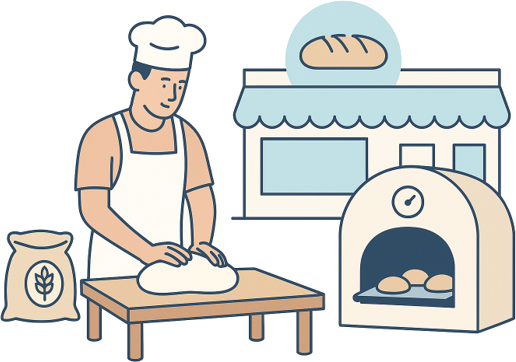
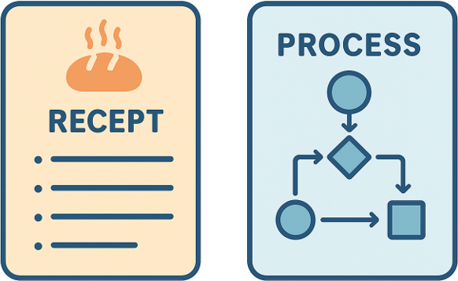
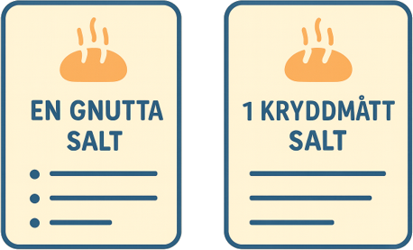
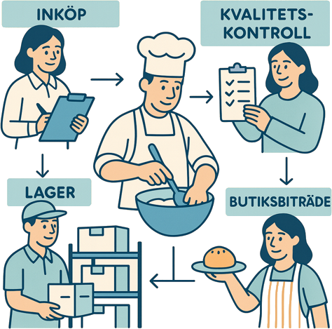
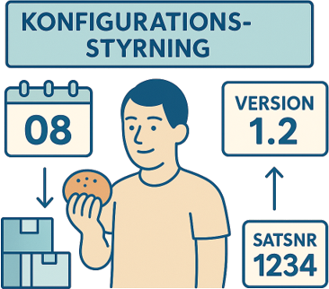

+++
date = '2026-10-18T19:19:04+02:00'
draft = true
title = 'Bageriet'
+++

Här kommer en lite förenklad variant av vad en process är och varför den behövs. Tänk att ni driver ett bageri. Ni vill att era bullar ska bli de godaste i stan och lägger ner stor möda på att hitta rätt ingredienser och ta fram ett egenkomponerat recept på de magiska bullarna. Ni lägger även stor möda på att få kunderna att känna sig välkomna och trivas.

I det här exemplet kan man säga att receptet är som en process. Det beskriver både VAD som ska vara i bullen, det vill säga vilka ingredienser som ska användas, som smör, mjöl och så vidare. 
Receptet ska även beskriva HUR man ska tillaga bullen. I vilken ordning ska ingredienserna blandas? Ska de vara rumstempererade eller kalla? Hur varm ska ugnen vara och hur länge ska bullarna gräddas?

Hur detaljerat ska man då beskriva receptet eller processen? En tumregel är att tänka så här:

**"Processen ska säkerställa att resultatet blir detsamma, oavsett vem som utför arbetet."**

Räcker det med att skriva en gnutta salt, eller ska man ange exakt hur mycket som ska användas? Jobbar man med ständiga förbättringar spelar det faktiskt inte så stor roll från början. Men det kommer vi till [senare](../constant_improvments/)...

Men för ett bageri är en process mycket större än bara ett recept. För att bullarna ska smaka likadant varje gång gäller det att man köper in samma ingredienser. Vill man ha hög kvalitet på bullarna behöver man också välja bra råvaror. Därför måste även inköp vara involverade så att rätt saker köps in. 
Hur vi förvarar råvarorna är också viktigt, så att mjölken och smöret inte blir dåliga eller kanske tar smak av något annat i lokalen. 
För att säkerställa en hög kvalitet bör man även ha någon form av kontroll, exempelvis genom att göra stickprov.

Konfigurationsstyrning är viktig för att kunna följa upp och spåra fel. Om några kunder kommer tillbaka en dag och är besvikna vill man kunna ta reda på varför just deras bullar inte smakade som de skulle, medan andra kunder var nöjda.
Det kanske visar sig att man har köpt en ny ugn. Genom att kunna spåra när bullarna bakades, vilken utrustning som användes och varifrån ingredienserna kom kan man identifiera felorsaken och rätta till problemet.

  <strong>Avslutningsvis</strong>

  

    Det här är en väldigt kort beskrivning av vad en process är, men förhoppningsvis blev det lite tydligare varför det är så viktigt att ha fungerande processer.
  

